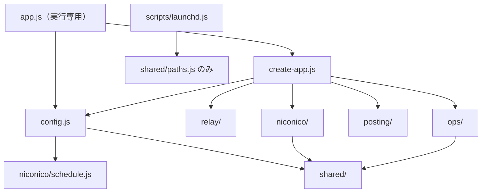

# sns-collaborator ドメイン設計

このリポジトリの設計書。この文書は、目指す構造と規則を述べる。

- **根拠**: `src/*.js`、`scripts/launchd.js`、`test/*.js`、`README.md`、discord.js 14.27.0 のソースを読んで確認した
- **外部インターフェース**: 第 7 章は外部との契約であり、内部の名前や構造が変わっても維持する

## 1. システムの概要

Discord の 1 チャンネルに流れるライブ配信の告知を Misskey と共有チャンネルへ流し、ニコニコ動画の新着を定刻に取得して 3 宛先へ告知する常駐 bot。macOS の launchd で動く。

| 入力 | 処理 | 出力 |
|------|------|------|
| Discord の messageCreate / messageUpdate | 中継 | Misskey のノート、共有チャンネルの投稿 |
| 定刻と nvapi の投稿一覧 | ニコニコ告知 | 告知チャンネル、共有チャンネル、Misskey のノート |
| Discord の接続状態と統計 | 運用監視 | heartbeat ファイル、ログ、異常時の終了 |

## 2. 境界づけられた文脈

### 2.1 文脈の切り分け

独立した文脈は 3 つ（中継、ニコニコ告知、運用監視）。ほかの区分は次の扱いにする。

| 区分 | 判定 | 理由 |
|------|------|------|
| 中継 | **文脈** | 適格判定、本文の確定、追跡記録という独自の規則と状態を持つ |
| 動画告知 | **文脈**（名称は「ニコニコ告知」） | 新着判定、未配信の追跡、状態ファイルを持つ。環境変数、ログ、heartbeat のすべてが「ニコニコ」を名乗っており、対象を一般化する予定もないので `niconico/` とする |
| 配信 | **文脈にしない**。外側のアダプタ `posting/` | 独自の状態も判定もなく、「宛先の形式で送る」だけ。再試行や宛先ごとの成否管理はニコニコ告知の規則で、配信側には置かない |
| 定刻実行 | **文脈にしない**。ニコニコ告知の一部 | 利用者はニコニコ告知だけ。ポーラーの再試行条件は告知サイクルの戻り値の形（`failed` / `ok` / `pending`）に結びつき、ログ文言もニコニコ専用。別の文脈にすると抽象だけが増える |
| 運用監視 | **文脈** | heartbeat、統計、ログ、自己終了。launchd も概念上ここに属するが、ファイルは `scripts/launchd.js` から動かさない（6.1） |
| 構成ルート | **文脈ではない**。`src/` 直下の 3 ファイル | ドメインの規則を持たず、設定の検証と配線だけを行う |

中継とニコニコ告知は同じ告知チャンネルを共有する。コードの依存はないが、運用上は結びついている。bot 自身がニコニコ告知を告知チャンネルへ投稿すると messageCreate で戻ってくるため、**中継の自己除外がなければ告知が Misskey へ二重に投稿される**。自己除外は中継の必須の規則である。

### 2.2 各文脈の責務と不変条件

#### 中継（`relay/`）

責務: 告知チャンネルの投稿を判定し、本文を確定して、Misskey への転送と共有投稿を行う。

| 投稿者 | `author.bot` | 転送 | 共有 | `botSkipped` | 除外ログ |
|--------|-------------|------|------|-------------|---------|
| 人間（`author` なしを含む） | 偽 | する | しない | 数えない | なし |
| 自分（selfId 一致） | 偽 | しない | しない | 数えない | なし |
| 自分（selfId 一致） | 真 | しない | しない | **数える** | **なし** |
| 許可 bot | 真 | する | する | 数えない | なし |
| 許可外 bot | 真 | しない | しない | 数える | あり |

- 共有を先に、Misskey 転送を後に実行する。互いの失敗は相手を止めない
- 本文の組み立て順は content → 各 embed の title → url。重複行を除き、3000 文字で切り詰める。切り詰めた本文を共有投稿でも使う
- 空本文は `skippedEmpty` に記録し、messageUpdate で本文が付いたときだけ転送する
- messageUpdate の経路は `received` / `targetChannel` / `botSkipped` / `emptySkipped` / `lastReceivedAt` を増やさない。`deliver` 経由の成功・失敗の統計（`forwardOk` / `forwardFail` / `shareOk` / `shareFail`）は増える。本文が空のままならログも出さない
- 本文ありの投稿が Misskey 転送に失敗しても再試行しない。空スキップを経た投稿だけ、Misskey が未転送の間は次の messageUpdate で未完了の宛先を再度試みる（共有が失敗し Misskey が成功した場合、`forwarded` に入るので共有は再試行されない）
- 追跡記録は 3 種類（`skippedEmpty` / `forwarded` / `shared`）で、それぞれ直近 100 件

#### ニコニコ告知（`niconico/`）

責務: nvapi の取得、新着判定、未配信の追跡、宛先への配信、定刻の判定、状態ファイルの管理。

- 宛先は `announce` → `twitter` → `misskey` の順で独立に配信し、成功するたびに状態を保存する
- `lastRunAt` は取得に成功したときだけ更新する。取得に失敗しても未配信の再試行は行う
- 状態ファイルが破損しているときは何も上書きしない。ERROR は状態が戻るまでの間に 1 回だけ出す
- 初回と `userId` の変更時はシードする（投稿しない。公開前の動画は既知にしない）
- 24 時間以上前の新規動画は告知せず既知に登録する。24 時間を過ぎた未配信は諦める
- 1 回の告知対象が 4 件以上なら異常として投稿せず既知に登録する
- 再試行待ちの間は `inspect` を呼ばず、状態ファイルを読まない
- 再試行の時刻はメモリ上だけで持つ。定刻の判定は JST 固定で、飛ばした定刻は復帰後に 1 回だけ実行する

#### 運用監視（`ops/`、`scripts/launchd.js`）

責務: 統計の保持、ログの形式、heartbeat の出力、Discord の接続ログ、READY 未達での自己終了、launchd の登録。

- heartbeat は logger を通さず、ステータスファイルを 1 行で上書きする
- 前回の確認から確認間隔の 2 倍を超えて経過したらスリープ復帰とみなし、未接続の判定をリセットする
- READY でない状態が上限を超えたら ERROR を出して終了コード 1 で終わり、launchd の再起動に任せる

#### 投稿アダプタ（`posting/`）

責務: Discord と Misskey への送信形式を 1 か所に持つ。文脈ではなく外側のアダプタ。

- Discord へのすべての送信に `allowedMentions: { parse: [] }` を付ける
- 取得したチャンネルが null、または `send` を持たないときは `Discord チャンネルに送信できません: id=<id>` で例外を投げる。`channels.fetch` 自体が reject したときは、そのエラーが元のまま伝わる

## 3. 用語集

### 3.1 統一名

設計文書とコードは次の名前を使う。

| 概念 | 日本語 | コード |
|------|--------|--------|
| ライブ配信告知を外へ流す処理全体 | 中継 | `relay` |
| 中継のうち Misskey へ流す部分 | 転送 | `forward`（`shouldForward`、`tracker.forwarded`） |
| 「ツイートする」ボタン付きの投稿 | 共有投稿 | `share` |
| 共有投稿を出すチャンネル | 共有チャンネル | `shareChannelId` |
| 告知が流れ、中継が監視するチャンネル | 告知チャンネル | `announceChannelId` |
| 中継で確定した本文 | 中継本文 | `buildRelayText`、`MAX_RELAY_TEXT_LENGTH` |
| Misskey の投稿 | ノート | `createNote` |
| 3 宛先共通の動画告知の本文 | 告知文 | `buildAnnouncementText` |
| 中継の処理済み記録 | 追跡記録 | `createRelayTracker` |
| ニコニコの新着を告知する処理 | ニコニコ告知 | `createNiconicoAnnouncer` |
| 取得・新着判定・配信の 1 回分 | 告知サイクル | `announcer.runCycle` |
| 実行すべきかの 1 分ごとの判定 | ポーリング判定 | `poller.pollOnce`、`POLL_INTERVAL_MS` |
| heartbeat 出力と READY 判定の 1 回分 | 生存確認 | `monitor.checkHealth` |
| 新着を確認する時刻 | 定刻 | `checkTimes` |
| 告知の送り先 3 種 | 宛先 | `DESTINATIONS` の各キー |
| 外への送信の部品 | 投稿アダプタ | `posting` |

`tick` は使わない。`check` は定刻の `checkTimes` と健全性の `checkHealth` のように、語を補った形でだけ使う。

状態ファイル由来の語（`known` 既知、`pending` 未配信、`delivered` 配信済み、`seed` シード）と、`stale`、`anomaly`、`selfId`、`allowedBotIds`、`inspect` も設計上の語として使う。

**「配信」の使い分け**: 日本語の「配信」には「ライブ配信」と「宛先への配信」の 2 つの意味がある。設計上の語として、ライブ配信はそのまま、宛先への送信は文脈内の処理を「配信」（`deliverPending`）、送信の部品を「投稿アダプタ」と呼ぶ。「配信」単独を文脈やディレクトリの名前にしない。

### 3.2 変えてはいけない外部名

次の名前は外部との契約で、内部の統一名とは別に固定する。意味が統一名とずれているものがあるので注意する。

| 外部名 | 場所 | 指すもの |
|--------|------|----------|
| `DISCORD_CHANNEL_ID` | 環境変数 | 告知チャンネル |
| `DISCORD_POST_CHANNEL_ID` | 環境変数 | 共有チャンネル |
| `NICONICO_CHECK_TIMES` | 環境変数 | 定刻 |
| `twitter` | 状態ファイル `delivered` のキー | 共有チャンネルという宛先 |
| `announce` | 状態ファイル `delivered` のキー | 告知チャンネルという宛先 |
| `監視チャンネル` | ログ文言 | 告知チャンネル |
| `twitter共有用チャンネル` | ログ文言 | 共有チャンネル |
| `targetChannel` | heartbeat のキー | 告知チャンネルで受けた投稿の数 |
| `forwardOk` / `forwardFail` | heartbeat のキー | Misskey への転送の成否（中継のみ） |
| `shareOk` / `shareFail` | heartbeat のキー | **ライブ配信の共有投稿の成否のみ**。ニコニコ告知の `twitter` 宛先は数えない |
| `ツイートする` | ボタンのラベル | 共有投稿のボタン |
| `TWEET_INTENT_URL` の値 | Twitter の intent URL | 外部サービスの URL |

## 4. 依存方向



### 4.1 規則

1. 依存は構成ルート → 各ディレクトリの一方向。**`relay/` と `niconico/` は互いに import しない**
2. `relay/` と `niconico/` は `posting/` も `ops/` も import しない。宛先は関数として、統計は値として構成ルートから受け取る
3. `shared/` は Node の組み込みモジュールだけに依存し、他のディレクトリを import しない
4. `*/rules.js` は何も import しない（例外は同じ文脈の定数のみ）
5. `discord.js` の import は `app.js`、`create-app.js`、`ops/discord-logging.js` に限る。`Client` の生成は `app.js` だけが行う。`misskey-js` の import は `app.js` だけが行う
6. `config.js` は環境変数を読む唯一のモジュール。`process.env` を直接参照するのは `app.js`（`createApp` への受け渡し）だけ
7. 既定引数に置いてよいのは時計（`now`）、タイマー（`setTimeoutFn` など）、数値定数だけ。logger、統計、追跡記録、ファイル書き込みを既定で生成しない。例外は `niconico/nvapi.js` の `fetchFn = fetch` で、アダプタ本体の既定値なので置く。ただし `createApp` は `fetchFn` を必須とし、常に明示して渡す

これらの規則は `test/architecture.test.js` が `src/` の import 文を読んで検査する。

### 4.2 純粋関数にする判定

| 場所 | 関数 | 内容 |
|------|------|------|
| `relay/rules.js` | `classifyAuthor(author, { allowedBotIds, selfId })` | `human` / `self` / `allowedBot` / `deniedBot` を返す。投稿者の分類はこの 1 つに集約する |
| | `shouldForward`、`shouldShare` | `classifyAuthor` の結果とチャンネルから決める |
| | `cleanDiscordText`、`buildRelayText` | 本文の確定 |
| `niconico/rules.js` | `classifyFetchedVideos(knownIds, items, nowMs)` | `stale`（入力順）、`fresh`（入力順）、異常の有無を返す |
| | `needsSeed(loaded, userId)` | シードが必要かの判定 |
| | `selectSeedVideos(all, nowMs)` | 公開前の動画を除く |
| | `createPendingEntry(video)`、`isExpired(entry, nowMs)`、`undeliveredDestinations(entry)` | 未配信 1 件の扱い |
| | `buildAnnouncementText`、`watchUrl` | 文面と URL |
| `niconico/schedule.js` | `parseCheckTimes`、`formatCheckTimes`、`latestScheduledAt` | 定刻の解析、整形、直近の定刻 |
| | `isScheduledRunDue(info, nowMs, checkTimes)`、`nextRetryAt(result, nowMs, retryIntervalMs)` | ポーリング判定の中核。再試行待ちの判定はポーラーが持ち、`inspect` は遅延呼び出しにする |
| `niconico/nvapi.js` | `normalizeItem` | nvapi の項目の正規化 |
| `posting/share.js` | `buildShareUrl`、`buildSharePayload` | 共有投稿の URL と payload |
| `ops/health.js` | `formatDuration`、`buildHeartbeatLine` | heartbeat 行の組み立て |
| `config.js` | `parseIdList`、`parseMinutes`、`loadConfig(env, home)` | 引数だけで決まる |

判定の挙動として固定する点:

- `classifyFetchedVideos` は古い動画だけを既知の集合に加え、新規の動画は加えない。同じ ID が重複して届くと、古い動画は 1 件、新規の動画は重複したまま数える
- `known` への追加順は状態ファイルに残る。古い動画を入力順に追加した後、通常は新規を `registeredAtMs` の昇順で、異常時は入力順で追加する

### 4.3 外側のアダプタと注入

| 対象 | 受け取り方 | 使う場所 |
|------|-----------|----------|
| Discord クライアント | `createApp` の `createDiscordClient(options)` | `posting/`、`ops/discord-logging.js`、生存確認の `getStatus` |
| Misskey クライアント | `createApp` の `createMisskeyClient(options)` | `posting/` |
| 送信 | 文脈には `(text) => Promise` の関数を渡す | 中継の `postNote` / `postShare`、ニコニコ告知の `destinations` |
| nvapi | `createApp` の `fetchFn`。`createApp` が `fetchPage` / `fetchAll` に束ねる | ニコニコ告知 |
| ファイル | `fs` そのものは注入しない。`createStateStore` と `createFileStatusWriter` をアダプタとして注入する | ニコニコ告知、生存確認 |
| 時計、タイマー | `now` / `setTimeoutFn` など | 各所 |
| プロセス | `exit`、`uptimeMs` | 生存確認の `onFatal`、`getStatus` |

`fs` の関数まで注入しないのは、状態ストアのテストが一時ディレクトリで実ファイルを扱っており、これ以上の注入は引数を増やすだけだからである。

## 5. ファイル構成

```
src/
  app.js                 実行専用の入口（dotenv、実依存の組み立て、起動、エラーの受け口）
  create-app.js          配線（副作用なしで import できる）
  config.js              環境変数の検証と設定オブジェクト
  relay/
    rules.js             投稿者の分類、転送・共有の判定、本文の確定（純粋）
    handlers.js          追跡記録、messageCreate / messageUpdate のハンドラ
  niconico/
    rules.js             告知文、新着判定、未配信の判定（純粋）
    announcer.js         告知サイクル（取得失敗の管理、シード、配信）
    state-store.js       状態ファイルの読み書きと検証
    poller.js            1 分ごとのポーリング
    schedule.js          JST の定刻計算（純粋）
    nvapi.js             nvapi の腐敗防止層
  posting/
    senders.js           Discord と Misskey への送信
    share.js             共有投稿の URL と payload（純粋）
  ops/
    health.js            生存確認、heartbeat 行、ステータス書き込み
    discord-logging.js   Discord の接続ログ、起動時のチャンネル確認
    stats.js             統計の形
    logger.js            ログの形式
  shared/
    atomic-file.js       一時ファイル + rename の書き込み
    paths.js             既定のログ・状態ファイルのパス
scripts/
  launchd.js             plist の生成と launchctl の操作
```

`test/` はフラットに置く（`test/*.test.js`）。`src/` は 19 ファイル（直下 3、`relay/` 2、`niconico/` 6、`posting/` 2、`ops/` 4、`shared/` 2）。

**ディレクトリ分割とフラット + 接頭辞の比較**: 文脈別に 1 階層のディレクトリへ分ける。フラットのまま `relay-rules.js` のように接頭辞を付ける案では `src/` の 19 ファイルが 1 か所に並び、`shared` と `ops` のような文脈以外の区分は接頭辞では表しにくい。ディレクトリに分けると `from '../relay/...'` という import の形だけで文脈をまたぐ依存が見え、4.1 の規則をパスの判定だけで検査できる。2 階層以上は、最大の `niconico/` でも 6 ファイルなので必要がない。

### 5.1 各ファイルの主な export

| ファイル | export | 内容 |
|----------|--------|------|
| `create-app.js` | `createApp` | 配線。6.4 |
| `config.js` | `REQUIRED_ENV`、`ConfigError`、`parseIdList`、`parseMinutes`、`loadConfig(env, home)` | `env` と `home` は必須引数 |
| `relay/rules.js` | `MAX_RELAY_TEXT_LENGTH`、`classifyAuthor`、`shouldForward`、`shouldShare`、`cleanDiscordText`、`buildRelayText` | 4.2 |
| `relay/handlers.js` | `createBoundedSet`、`createRelayTracker`、`createRelayHandlers` | `createRelayHandlers` は `{ announceChannelId, allowedBotIds, selfId, postNote, postShare, tracker, logger, stats, now }` を受け取り、`onMessageCreate` / `onMessageUpdate` を返す。`selfId` は関数。`postShare` は `null` を取れる（`DISCORD_POST_CHANNEL_ID` 未設定時は共有をしない） |
| `niconico/rules.js` | `STALE_MS`、`ANOMALY_THRESHOLD`、`DESTINATIONS`、4.2 の各関数 | |
| `niconico/announcer.js` | `POLL_PAGE_SIZE`、`FAILURE_ALERT_THRESHOLD`、`createNiconicoAnnouncer` | `fetchPage` / `fetchAll` は必須で、既定引数を持たない |
| `niconico/state-store.js` | `createStateStore` | |
| `niconico/poller.js` | `POLL_INTERVAL_MS`、`RETRY_INTERVAL_MS`、`createPoller` | |
| `niconico/schedule.js` | `DEFAULT_CHECK_TIMES`、`parseCheckTimes`、`formatCheckTimes`、`latestScheduledAt`、`isScheduledRunDue`、`nextRetryAt` | |
| `niconico/nvapi.js` | `NVAPI_ORIGIN`、`DEFAULT_TIMEOUT_MS`、`SEED_PAGE_SIZE`、`MAX_SEED_PAGES`、`NiconicoError`、`normalizeItem`、`fetchUserVideosPage`、`fetchAllUserVideos` | |
| `posting/senders.js` | `createPosting({ discordClient, misskeyClient })` | `{ sendText, sendShare(channelId, text), createNote }` を返す |
| `posting/share.js` | `TWEET_INTENT_URL`、`MAX_BUTTON_URL_LENGTH`、`buildShareUrl`、`buildSharePayload` | ボタンの component の type は `discord.js` を import せず、ローカル定数で持つ |
| `ops/health.js` | `formatDuration`、`buildHeartbeatLine`、`createFileStatusWriter`、`createHealthMonitor` | `createHealthMonitor` は `writeStatus` の既定を持たず、`checkHealth` を公開する |
| `ops/discord-logging.js` | `attachDiscordLogging`、`reportAnnounceChannel` | |
| `ops/stats.js` | `createStats` | 戻り値の形は 6.3 |
| `ops/logger.js` | `createLogger` | 必須メソッドは `info` / `warn` / `error` |
| `shared/atomic-file.js` | `writeFileAtomic(file, content)` | 改行の有無は呼び出し側が `content` で決める |
| `shared/paths.js` | `appLogDir`、`defaultStatusFile`、`defaultStateFile` | すべて `home` を引数に取る。環境変数の判定は `config.js` が行う |
| `scripts/launchd.js` | `LABEL`、`escapeXml`、`buildPlist` | ログ配下のパスは `shared/paths.js` の `appLogDir` から得る |

## 6. 個別の判断

### 6.1 `scripts/launchd.js` と `src` の関係

**`src/shared/paths.js` にだけ依存する。** heartbeat の置き場所と plist の `StandardOutPath` が同じディレクトリであることは運用上の前提（README はそこを見るよう案内している）で、この場所の定義は 1 つに保つ。`shared/paths.js` は `node:path` だけに依存し副作用もないので、`npm install` 前でも実行でき、import の副作用もない。plist のパス（`LaunchAgents` 配下）と `LABEL` は launchd だけの知識なのでスクリプトに置く。スクリプト自体は `WorkingDirectory` を自分の位置から解決しているため、場所を動かさない。

### 6.2 時間定数

**watch URL は `niconico/rules.js` に一本化し、`MIN` / `HOUR` などの時間定数は共通化しない。** 1 分が 60000 ミリ秒であることは変わりようのない事実で、重複していても修正漏れは起きない。共通化しても文脈間に import が増えるだけである。

### 6.3 stats の共有方法

**`createStats()` の形を文脈別の 2 つのスライスにし、各文脈には自分のスライスだけを渡す。**

```js
{
  relay: { received, targetChannel, botSkipped, emptySkipped,
           forwardOk, forwardFail, shareOk, shareFail, lastReceivedAt },
  niconico: { niconicoOk, niconicoFail, niconicoAnnounced },
}
```

- 文脈は自分のスライスを加算するだけで、読むのは `ops/health.js` だけ
- 内部名は heartbeat のキーと同じにする。`grep` で heartbeat のキーから加算箇所に辿れるよう、接頭辞も省かない。`lastReceivedAt` は値が epoch ms で heartbeat の ISO 文字列（`lastReceived`）と異なるので名前も分ける
- 関数経由の記録（`record('forwardOk')`）やイベント通知は、規模に対して手間が見合わないので採らない。文脈ごとにカウンタを持って `snapshot()` で集める案も、配線が増えるだけなので採らない
- `createStats()` が全キーを 0 で初期化するので、読む側は `?? 0` を要しない

### 6.4 `createApp` の注入の形

```js
createApp({
  env, homeDir, logger, now, fetchFn,
  setTimeoutFn, setIntervalFn,
  createDiscordClient, createMisskeyClient, uptimeMs, exit,
}) // => { start(), stop(), monitor }
```

- すべて必須。`app.js` が実物を渡す（`createDiscordClient: (options) => new Client(options)` など）
- `create-app.js` が `fetchFn` を `fetchPage` / `fetchAll` に束ねて `createNiconicoAnnouncer` へ渡す。announcer は既定の取得経路を持たないので、配線テストが既定の `fetch` で実際の nvapi に接続することがない
- `setTimeoutFn` はニコニコのポーラー、`setIntervalFn` は生存確認に渡す。配線テストが両方のタイマーを制御し、ポーラーの 0ms タイマーが勝手に走らないようにする。`stop()` は `monitor.stop()` とポーラーの停止（ClientReady 後に作られていれば）を行い、配線テストは一時ディレクトリを削除する前に必ず呼ぶ。タイマーを注入で保留にしておけば、ポーラーが削除中のディレクトリを読むことはない
- `createApp` は同期関数。`loadConfig` → クライアント生成 → 統計 → イベント登録 → 生存確認の生成、の順で行う。`ConfigError` はこの中で同期的に投げられ、`app.js` の `main` の catch で扱う（`error.message` だけをログに出して `exitCode = 1`）
- `start()` は `monitor.start()` の後に `login`。ログイン失敗時に `discordClient.destroy()` は呼ばない
- インテントの指定は `create-app.js` が持ち、`createDiscordClient({ intents })` に渡す。配線テストはこの引数を検証できる。Partials は渡さない
- テストは `homeDir` に一時ディレクトリを渡す。既定パスの heartbeat や状態ファイルに書かないため。戻り値の `monitor` は配線テストの検証用で、`monitor.checkHealth()` を `now` の注入と組み合わせて呼ぶ。1 回の進みを確認間隔の 2 倍以下にしないとスリープ復帰と判定され、未接続の判定がリセットされることに注意する
- `createApp` は `config.health.statusFile` から `createFileStatusWriter` を作って生存確認に明示して渡す。テストが実際の heartbeat に書かないのは、`homeDir` を差し替えるためである
- discord.js は `ClientReady` に `client` 自身を渡す（`WebSocketManager.js:401`）ので、`posting` は最初に作ったクライアントで 1 度だけ生成する

設定オブジェクトの形:

```js
{
  discordToken, announceChannelId, misskeyInstanceUrl, misskeyApiToken,
  allowedBotIds,
  shareChannelId,            // string | null
  niconico: null | { userId, checkTimes, stateFile },
  health: { statusFile, maxNotReadyMs },
}
```

検証は、必須 4 変数 → `NICONICO_USER_ID` の形式 → `DISCORD_POST_CHANNEL_ID` の有無 → `NICONICO_CHECK_TIMES` の形式、の順に行う。`parseMinutes` は不正値のとき警告なしで既定値にする。

### 6.5 partial メッセージを扱わない

**`messageUpdate` ハンドラは partial メッセージを扱わない（`fetch` で補完する分岐を持たない）。** Partials を指定しないため、partial なメッセージはハンドラに届かない。

1. `app.js` は `Partials` を指定していない。discord.js の `Action.getPayload` は partials の指定がなければキャッシュ済みのメッセージしか返さず、キャッシュにないメッセージの更新では `messageUpdate` が発火しない（`MessageUpdate.js`、`MESSAGE_UPDATE.js`）
2. キャッシュ済みのメッセージは MESSAGE_CREATE を経ていて `content` と `author` を持つ。`Message#partial` は `typeof content !== 'string' || !author` で判定するので偽になる
3. 将来 Partials を有効にするなら、補完の処理より先に追跡記録の前提（create を経たメッセージだけが対象）を見直す必要がある

## 7. 外部インターフェース

次は外部との契約で、内部識別子（統計の内部名、関数名、設定オブジェクトのキー）とは別に固定する。

### 7.1 環境変数（11 個）

| 変数 | 必須 | 既定 | 空・不正値 |
|------|------|------|-----------|
| `DISCORD_TOKEN` | 必須 | なし | `ConfigError` |
| `DISCORD_CHANNEL_ID` | 必須 | なし | `ConfigError` |
| `MISSKEY_INSTANCE_URL` | 必須 | なし | `ConfigError`（形式は検証しない） |
| `MISSKEY_API_TOKEN` | 必須 | なし | `ConfigError` |
| `DISCORD_ALLOWED_BOT_IDS` | 任意 | 空 | カンマ区切り、空白除去、空要素除去。空なら全 bot を除外 |
| `DISCORD_POST_CHANNEL_ID` | 任意（`NICONICO_USER_ID` 設定時は必須） | なし（共有オフ） | ニコニコ有効で空なら `ConfigError` |
| `NICONICO_USER_ID` | 任意 | 機能オフ | 空はオフ。空白のみや数字以外は `ConfigError` |
| `NICONICO_CHECK_TIMES` | 任意 | `12:30,21:30` | 不正・重複は `ConfigError`。ニコニコ無効時は検証しない。`9:05` も受理する |
| `NICONICO_STATE_FILE` | 任意 | `<HOME>/Library/Application Support/sns-collaborator/niconico-state.json` | 空は既定。`~` は展開しない |
| `HEALTH_STATUS_FILE` | 任意 | `<HOME>/Library/Logs/sns-collaborator/heartbeat.log` | 空は既定。`~` は展開しない |
| `HEALTH_MAX_NOT_READY_MINUTES` | 任意 | `5` | 有限の正の数でなければ警告なしで既定値 |

`.env` は cwd から読む（`dotenv.config()`）。`src/app.js` のパス、`npm start` が `node src/app.js` であることも契約に含める。

`ConfigError` の文言:

- `必須の環境変数が設定されていません: <変数,...>` + 改行 + `.env ファイルまたは環境変数で設定してください（README 参照）。`
- `NICONICO_USER_ID は数字のユーザー ID を指定してください。`
- `必須の環境変数が設定されていません: DISCORD_POST_CHANNEL_ID（NICONICO_USER_ID 設定時は必須）`
- `NICONICO_CHECK_TIMES が不正です: 不正な時刻です: "<値>"（HH:MM 形式、カンマ区切り）`
- `NICONICO_CHECK_TIMES が不正です: 時刻が重複しています: <値>`

### 7.2 状態ファイル（`niconico-state.json`）

```json
{
  "version": 1,
  "userId": "<数字のユーザー ID>",
  "known": ["sm1", "sm2"],
  "pending": {
    "sm3": {
      "title": "...",
      "url": "https://www.nicovideo.jp/watch/sm3",
      "registeredAt": "2026-11-09T21:00:00+09:00",
      "delivered": { "announce": true, "twitter": false, "misskey": false }
    }
  },
  "lastRunAt": 1794225600000
}
```

- キー名と `version: 1` は固定。書き込みは `JSON.stringify(state, null, 2)`（末尾改行なし）を `<file>.<pid>.tmp` に書いてから rename する
- `pending[].url` はコード上で読まれないが、検証（`typeof p.url === 'string'`）の対象なので書く。欠けると、検証を行う版では破損扱いになる
- 保存のタイミング: シード時に 1 回、取得成功時に 1 回、宛先の配信成功ごと、諦めた時、全宛先の完了時
- 未知のキーは無視する。`delivered` の欠けたキーは未配信として扱う

### 7.3 heartbeat

```
[<ISO8601>] heartbeat ws=<READY|NOT_READY> ping=<ms>ms uptime=<d>d<h>h<m>m<s>s received=<n> targetChannel=<n> botSkipped=<n> emptySkipped=<n> forwardOk=<n> forwardFail=<n> shareOk=<n> shareFail=<n> niconicoOk=<n> niconicoFail=<n> niconicoAnnounced=<n> lastReceived=<ISO8601|なし>
```

15 キーの名前と順序、半角スペース区切り、行末の改行、1 行の上書き（一時ファイル + rename）、既定 1 分周期は固定。行頭に LEVEL は付かない。

### 7.4 ログ

形式は `[<ISO8601>] <LEVEL> <message>`。INFO / WARN は stdout、ERROR は stderr。次の全文言は契約で、変えない。「README」列が ✓ のものは利用者向けの契約でもある。

| レベル | 文言 | README |
|--------|------|--------|
| ERROR | `Discord client error:` + error | |
| WARN | `Discord warn:` + message | ✓ |
| WARN | `shard <id> 切断 code=<code> reason=<reason>` | ✓ |
| WARN | `shard <id> 再接続中` | ✓ |
| INFO | `shard <id> 再開 (replayed events=<n>)` | ✓ |
| ERROR | `shard <id> エラー:` + error | ✓ |
| ERROR | `Discord セッションが無効化されました (invalidated)` | ✓ |
| INFO | `ログイン完了: <tag> / 監視チャンネルID=<id>` | ✓ |
| INFO | `監視チャンネル取得成功: name=<name または (名前なし)> id=<id>` | ✓ |
| ERROR | `監視チャンネルが見つかりません: id=<id>` | ✓ |
| ERROR | `監視チャンネルの取得に失敗しました (ID違い・権限不足・未参加の可能性): id=<id>` + error | ✓ |
| INFO | `ニコニコ動画の新着告知を開始: userId=<id> 定刻(JST)=<HH:MM,...>` | |
| ERROR | `<ConfigError の message>` | |
| ERROR | `起動に失敗しました:` + error | |
| INFO | `Misskeyへの投稿が成功しました。`（許可 bot は ` (許可 bot author=<…> id=<…>)` を付加） | ✓ |
| ERROR | `Misskeyへの投稿に失敗しました:` + error | ✓ |
| INFO | `twitter共有用チャンネルへの投稿が成功しました。 (許可 bot author=<…> id=<…>)` | |
| ERROR | `twitter共有用チャンネルへの投稿に失敗しました:` + error | |
| INFO | `bot 発言を除外しました: author=<tag、username、(不明)> id=<id、(不明)>（転送するには DISCORD_ALLOWED_BOT_IDS に ID を追加）` | ✓ |
| INFO | `転送する本文が空のためスキップ` | ✓ |
| INFO | `更新で本文が付与されたため転送します` | |
| ERROR | `messageUpdate の処理に失敗しました:` + error | |
| WARN | `ニコニコ動画の取得に失敗しました (連続<n>回): <message>` | |
| ERROR | `ニコニコ動画の取得が <n> 回連続で失敗しています` | |
| INFO | `ニコニコ動画の取得が回復しました (失敗<n>回後)` | |
| WARN | `古い新規動画のため告知せず既知に登録します: id=<id> registeredAt=<ISO>` | |
| ERROR | `告知対象が <n> 件あり異常のため投稿せず既知に登録します: <id,...>` | |
| ERROR | `24時間を過ぎた未配信を諦めます: id=<id> 未配信=<宛先,...>` | |
| ERROR | `告知の配信に失敗しました (次回再試行): id=<id> 宛先=<dest>` + error | |
| INFO | `告知を配信しました: id=<id> 宛先=<dest>` | |
| INFO | `ニコニコ動画の初回シード完了: <n> 件を既知に登録しました（投稿なし）`（除外があれば ` / 公開前の <m> 件は除外` を付加） | |
| ERROR | `ニコニコ動画の状態ファイルが不正なため何もしません (<file>): <reason>` | |
| ERROR | `ニコニコ動画のポーリングで予期しないエラー:` + error | |
| INFO | `スリープ復帰を検知しました（前回チェックから <dur> 経過）。再接続の猶予のため未接続判定をリセットします` | ✓ |
| INFO | `ステータスファイルの書き込みが回復しました` | |
| ERROR | `ステータスファイルの書き込みに失敗しました: <message>` | |
| ERROR | `Discord が READY でない状態が <dur> 続いたため終了します（自動再起動を期待）` | ✓ |

### 7.5 launchd

`LABEL` は `local.sns-collaborator`。`scripts/launchd.js` の場所、`npm start` の実行、`RunAtLoad`、`KeepAlive.SuccessfulExit=false`、`ThrottleInterval=60`、`out.log` / `err.log` の分離、`WorkingDirectory` をスクリプトの親ディレクトリから解決すること、PATH の並び、`npm run launchd:*` の名前は契約である。

### 7.6 投稿形式

| 宛先 | 形式 |
|------|------|
| Misskey（中継、ニコニコ共通） | `notes/create` に `{ text }` のみ。`visibility` などを足さない |
| 告知チャンネル（ニコニコ） | `{ content: <告知文>, allowedMentions: { parse: [] } }` |
| 共有チャンネル（中継、ニコニコ共通） | 下記の共有 payload |

告知文は `動画を投稿しました！\n<title>\nhttps://www.nicovideo.jp/watch/<id>` で 3 宛先共通。切り詰めない。

```json
{
  "content": "",
  "embeds": [{ "description": "<本文>" }],
  "components": [{
    "type": 1,
    "components": [{ "type": 2, "style": 5, "label": "ツイートする",
      "url": "https://twitter.com/intent/tweet?text=<encodeURIComponent(切り詰め後の本文)>" }]
  }],
  "allowedMentions": { "parse": [] }
}
```

ボタン URL は全体で 512 文字以下。3 行以上なら先頭行と末尾行を残して中間を `…` で切り詰め、2 行以下なら末尾を切り詰める（コードポイント単位）。

### 7.7 その他の外部接点

- Discord の intents: `Guilds`、`GuildMessages`、`MessageContent`。Partials は指定しない
- nvapi: `https://nvapi.nicovideo.jp/v2/users/<userId>/videos?sortKey=registeredAt&sortOrder=desc&pageSize=<n>&page=<n>`、ヘッダ `X-Frontend-Id: 6` と `User-Agent: sns-collaborator`、タイムアウト 15 秒、新着はページサイズ 20 の 1 ページ目のみ、シードはサイズ 100 で最大 50 ページ（途中の失敗で全体失敗）
- しきい値: 再試行 5 分、ポーリング 1 分、古さ 24 時間、異常 4 件、連続失敗の ERROR は 3 回、追跡記録 100 件、生存確認 1 分
