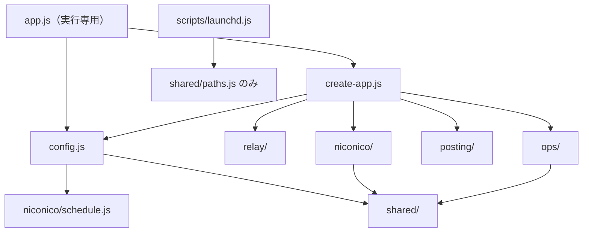

# sns-collaborator ドメイン設計

このリポジトリの現行の設計書。リファクタリング R1〜R5 の入力であり、完了後も設計の基準として残す。

- **基準コミット**: `e6655cb`。文中の `file:line` はこのコミットの行番号
- **根拠**: `src/*.js`、`scripts/launchd.js`、`test/*.js`、`README.md`、discord.js 14.27.0 のソースを読んで確認した。テストと bot は実行していない
- **番号**: AP（設計上の問題）、F（不具合の疑い）、C（特性テストの項目）、Rn（リファクタの PR）はリポジトリ外の作業計画の ID。本文だけで判断できるよう、必要な内容は各節に書いた
- **更新の規則**: 5.1 節と第 7 章は移行中の作業指示なので、R5 の完了時に削除する。第 8 章は移行後も外部契約として維持する

## 1. システムの概要

Discord の 1 チャンネルに流れるライブ配信の告知を Misskey と共有チャンネルへ流し、ニコニコ動画の新着を定刻に取得して 3 宛先へ告知する常駐 bot。macOS の launchd で動く。

| 入力 | 処理 | 出力 |
|------|------|------|
| Discord の messageCreate / messageUpdate | 中継 | Misskey のノート、共有チャンネルの投稿 |
| 定刻と nvapi の投稿一覧 | ニコニコ告知 | 告知チャンネル、共有チャンネル、Misskey のノート |
| Discord の接続状態と統計 | 運用監視 | heartbeat ファイル、ログ、異常時の終了 |

## 2. 境界づけられた文脈

### 2.1 候補の検証

計画書の 6 候補のうち、独立した文脈として残すのは 3 つ（中継、ニコニコ告知、運用監視）。残りは次の扱いにする。

| 候補 | 判定 | 理由 |
|------|------|------|
| 中継 | **文脈** | 適格判定、本文の確定、追跡記録という独自の規則と状態を持つ |
| 動画告知 | **文脈**（名称は「ニコニコ告知」） | 新着判定、未配信の追跡、状態ファイルを持つ。環境変数、ログ、heartbeat のすべてが「ニコニコ」を名乗っており、対象を一般化する予定もないので `niconico/` とする |
| 配信 | **文脈にしない**。外側のアダプタ `posting/` | 独自の状態も判定もなく、「宛先の形式で送る」だけ。再試行や宛先ごとの成否管理はニコニコ告知の規則で、配信側には置かない |
| 定刻実行 | **文脈にしない**。ニコニコ告知の一部 | 利用者はニコニコ告知だけ。ポーラーの再試行条件は `tick` の戻り値の形（`failed` / `ok` / `pending`）に結びつき、ログ文言もニコニコ専用。別の文脈にすると抽象だけが増える |
| 運用監視 | **文脈** | heartbeat、統計、ログ、自己終了。launchd も概念上ここに属するが、ファイルは `scripts/launchd.js` から動かさない（6.1） |
| 構成ルート | **文脈ではない**。`src/` 直下の 3 ファイル | ドメインの規則を持たず、設定の検証と配線だけを行う |

中継とニコニコ告知は同じ告知チャンネルを共有する。コードの依存はないが、運用上は結びついている。bot 自身がニコニコ告知を告知チャンネルへ投稿すると messageCreate で戻ってくるため、**中継の自己除外がなければ告知が Misskey へ二重に投稿される**。自己除外は中継の必須の規則である。

### 2.2 各文脈の責務と不変条件

#### 中継（`relay/`）

責務: 告知チャンネルの投稿を判定し、本文を確定して、Misskey への転送と共有投稿を行う。

| 投稿者 | `author.bot` | 転送 | 共有 | `botSkipped` | 除外ログ |
|--------|-------------|------|------|-------------|---------|
| 人間（`author` なしを含む） | 偽 | する | しない | 数えない | なし |
| 自分（selfId 一致） | 偽 | しない | しない | 数えない | なし |
| 自分（selfId 一致） | 真 | しない | しない | **数える** | **なし** |
| 許可 bot | 真 | する | する | 数えない | なし |
| 許可外 bot | 真 | しない | しない | 数える | あり |

- 共有を先に、Misskey 転送を後に実行する。互いの失敗は相手を止めない
- 本文の組み立て順は content → 各 embed の title → url。重複行を除き、3000 文字で切り詰める。切り詰めた本文を共有投稿でも使う（決定済み。AP20 は解消しない）
- 空本文は `skippedEmpty` に記録し、messageUpdate で本文が付いたときだけ転送する
- messageUpdate の経路は `received` / `targetChannel` / `botSkipped` / `emptySkipped` / `lastReceivedAt` を増やさない。`deliver` 経由の成功・失敗の統計（`forwardOk` / `forwardFail` / `shareOk` / `shareFail`）は増える。本文が空のままならログも出さない
- 本文ありの投稿が Misskey 転送に失敗しても再試行しない。空スキップを経た投稿だけ、Misskey が未転送の間は次の messageUpdate で未完了の宛先を再度試みる（共有が失敗し Misskey が成功した場合、`forwarded` に入るので共有は再試行されない）
- 追跡記録は 3 種類（`skippedEmpty` / `forwarded` / `shared`）で、それぞれ直近 100 件

#### ニコニコ告知（`niconico/`）

責務: nvapi の取得、新着判定、未配信の追跡、宛先への配信、定刻の判定、状態ファイルの管理。

- 宛先は `announce` → `twitter` → `misskey` の順で独立に配信し、成功するたびに状態を保存する
- `lastRunAt` は取得に成功したときだけ更新する。取得に失敗しても未配信の再試行は行う
- 状態ファイルが破損しているときは何も上書きしない。ERROR は状態が戻るまでの間に 1 回だけ出す
- 初回と `userId` の変更時はシードする（投稿しない。公開前の動画は既知にしない）
- 24 時間以上前の新規動画は告知せず既知に登録する。24 時間を過ぎた未配信は諦める
- 1 回の告知対象が 4 件以上なら異常として投稿せず既知に登録する
- 再試行待ちの間は `inspect` を呼ばず、状態ファイルを読まない
- 再試行の時刻はメモリ上だけで持つ。定刻の判定は JST 固定で、飛ばした定刻は復帰後に 1 回だけ実行する

#### 運用監視（`ops/`、`scripts/launchd.js`）

責務: 統計の保持、ログの形式、heartbeat の出力、Discord の接続ログ、READY 未達での自己終了、launchd の登録。

- heartbeat は logger を通さず、ステータスファイルを 1 行で上書きする
- 前回の確認から確認間隔の 2 倍を超えて経過したらスリープ復帰とみなし、未接続の判定をリセットする
- READY でない状態が上限を超えたら ERROR を出して終了コード 1 で終わり、launchd の再起動に任せる

#### 投稿アダプタ（`posting/`）

責務: Discord と Misskey への送信形式を 1 か所に持つ。文脈ではなく外側のアダプタ。

- Discord へのすべての送信に `allowedMentions: { parse: [] }` を付ける
- 取得したチャンネルが null、または `send` を持たないときは `Discord チャンネルに送信できません: id=<id>` で例外を投げる。`channels.fetch` 自体が reject したときは、そのエラーが元のまま伝わる

## 3. 用語集

### 3.1 統一名

新しいコードと文書は次の名前を使う。別名は移行の中で消す。

| 概念 | 日本語 | コード | 廃止する別名 |
|------|--------|--------|-------------|
| ライブ配信告知を外へ流す処理全体 | 中継 | `relay` | `forwarder`（ファイル名） |
| 中継のうち Misskey へ流す部分 | 転送 | `forward`（`shouldForward`、`tracker.forwarded`） | |
| 「ツイートする」ボタン付きの投稿 | 共有投稿 | `share` | `tweet`（関数名）、`twitter`（内部変数） |
| 共有投稿を出すチャンネル | 共有チャンネル | `shareChannelId` | `postChannelId`、`twitterChannelId` |
| 告知が流れ、中継が監視するチャンネル | 告知チャンネル | `announceChannelId` | `channelId` |
| 中継で確定した本文 | 中継本文 | `buildRelayText`、`MAX_RELAY_TEXT_LENGTH` | `buildNoteText`、`MAX_NOTE_LENGTH` |
| Misskey の投稿 | ノート | `createNote` | |
| 3 宛先共通の動画告知の本文 | 告知文 | `buildAnnouncementText` | |
| 中継の処理済み記録 | 追跡記録 | `createRelayTracker` | `createForwardTracker` |
| ニコニコの新着を告知する処理 | ニコニコ告知 | `createNiconicoAnnouncer` | `createAnnouncer` |
| 取得・新着判定・配信の 1 回分 | 告知サイクル | `announcer.runCycle` | `tick` |
| 実行すべきかの 1 分ごとの判定 | ポーリング判定 | `poller.pollOnce`、`POLL_INTERVAL_MS` | `check`、`CHECK_INTERVAL_MS` |
| heartbeat 出力と READY 判定の 1 回分 | 生存確認 | `monitor.checkHealth` | `tick` |
| 新着を確認する時刻 | 定刻 | `checkTimes` | |
| 告知の送り先 3 種 | 宛先 | `DESTINATIONS` の各キー | |
| 外への送信の部品 | 投稿アダプタ | `posting` | |

`tick` は今後どこでも使わない。`check` は定刻の `checkTimes` と健全性の `checkHealth` のように、語を補った形でだけ使う。

状態ファイル由来の語（`known` 既知、`pending` 未配信、`delivered` 配信済み、`seed` シード）と、`stale`、`anomaly`、`selfId`、`allowedBotIds`、`inspect` は現行のまま使う。

**「配信」の使い分け**: 日本語の「配信」は「ライブ配信」と「宛先への配信」の 2 つの意味で使われてきた。設計上の語として、ライブ配信はそのまま、宛先への送信は文脈内の処理を「配信」（`deliverPending`）、送信の部品を「投稿アダプタ」と呼ぶ。「配信」単独を文脈やディレクトリの名前にしない。

### 3.2 変えてはいけない外部名

内部名を統一しても、次の名前は変えない。意味が統一名とずれているものがあるので注意する。

| 外部名 | 場所 | 指すもの |
|--------|------|----------|
| `DISCORD_CHANNEL_ID` | 環境変数 | 告知チャンネル |
| `DISCORD_POST_CHANNEL_ID` | 環境変数 | 共有チャンネル |
| `NICONICO_CHECK_TIMES` | 環境変数 | 定刻 |
| `twitter` | 状態ファイル `delivered` のキー | 共有チャンネルという宛先 |
| `announce` | 状態ファイル `delivered` のキー | 告知チャンネルという宛先 |
| `監視チャンネル` | ログ文言 | 告知チャンネル |
| `twitter共有用チャンネル` | ログ文言 | 共有チャンネル |
| `targetChannel` | heartbeat のキー | 告知チャンネルで受けた投稿の数 |
| `forwardOk` / `forwardFail` | heartbeat のキー | Misskey への転送の成否（中継のみ） |
| `shareOk` / `shareFail` | heartbeat のキー | **ライブ配信の共有投稿の成否のみ**。ニコニコ告知の `twitter` 宛先は数えない |
| `ツイートする` | ボタンのラベル | 共有投稿のボタン |
| `TWEET_INTENT_URL` の値 | Twitter の intent URL | 外部サービスの URL |

## 4. 依存方向



### 4.1 規則

1. 依存は構成ルート → 各ディレクトリの一方向。**`relay/` と `niconico/` は互いに import しない**
2. `relay/` と `niconico/` は `posting/` も `ops/` も import しない。宛先は関数として、統計は値として構成ルートから受け取る
3. `shared/` は Node の組み込みモジュールだけに依存し、他のディレクトリを import しない
4. `*/rules.js` は何も import しない（例外は同じ文脈の定数のみ）
5. `discord.js` の import は `app.js`、`create-app.js`、`ops/discord-logging.js` に限る。`Client` の生成は `app.js` だけが行う。`misskey-js` の import は `app.js` だけが行う
6. `config.js` は環境変数を読む唯一のモジュール。`process.env` を直接参照するのは `app.js`（`createApp` への受け渡し）だけ
7. 既定引数に置いてよいのは時計（`now`）、タイマー（`setTimeoutFn` など）、数値定数だけ。logger、統計、追跡記録、ファイル書き込みを既定で生成しない。例外は `niconico/nvapi.js` の `fetchFn = fetch` で、アダプタ本体の既定値なので残す。ただし `createApp` は `fetchFn` を必須とし、常に明示して渡す

これらの規則は R5 で `test/architecture.test.js` に固定する。`src/` の import 文を読むだけの短いテストで、新しい依存は要らない。

### 4.2 純粋関数にする判定

| 場所 | 関数 | 内容 |
|------|------|------|
| `relay/rules.js` | `classifyAuthor(author, { allowedBotIds, selfId })` | `human` / `self` / `allowedBot` / `deniedBot` を返す。AP05 の 3 か所をこの 1 つに集約する |
| | `shouldForward`、`shouldShare` | `classifyAuthor` の結果とチャンネルから決める |
| | `cleanDiscordText`、`buildRelayText` | 本文の確定 |
| `niconico/rules.js` | `classifyFetchedVideos(knownIds, items, nowMs)` | `stale`（入力順）、`fresh`（入力順）、異常の有無を返す |
| | `needsSeed(loaded, userId)` | AP14 の重複を解消する |
| | `selectSeedVideos(all, nowMs)` | 公開前の動画を除く |
| | `createPendingEntry(video)`、`isExpired(entry, nowMs)`、`undeliveredDestinations(entry)` | 未配信 1 件の扱い |
| | `buildAnnouncementText`、`watchUrl` | 文面と URL |
| `niconico/schedule.js` | `parseCheckTimes`、`formatCheckTimes`、`latestScheduledAt` | 現行のまま |
| | `isScheduledRunDue(info, nowMs, checkTimes)`、`nextRetryAt(result, nowMs, retryIntervalMs)` | ポーリング判定から抽出する。再試行待ちの判定はポーラーに残し、`inspect` を遅延呼び出しのままにする |
| `niconico/nvapi.js` | `normalizeItem` | 現行のまま |
| `posting/share.js` | `buildShareUrl`、`buildSharePayload` | 現行のまま |
| `ops/health.js` | `formatDuration`、`buildHeartbeatLine` | heartbeat 行の組み立てを抽出する |
| `config.js` | `parseIdList`、`parseMinutes`、`loadConfig(env, home)` | 引数だけで決まる |

抽出時に変えてはいけない点:

- `collectNew` は古い動画だけをループ内で既知の集合に加え、新規の動画は加えない。同じ ID が重複して届くと、古い動画は 1 件、新規の動画は重複したまま数える。`classifyFetchedVideos` はこの挙動を保つ
- `known` への追加順は状態ファイルに残る。古い動画を入力順に追加した後、通常は新規を `registeredAtMs` の昇順で、異常時は入力順で追加する

### 4.3 外側のアダプタと注入

| 対象 | 受け取り方 | 使う場所 |
|------|-----------|----------|
| Discord クライアント | `createApp` の `createDiscordClient(options)` | `posting/`、`ops/discord-logging.js`、生存確認の `getStatus` |
| Misskey クライアント | `createApp` の `createMisskeyClient(options)` | `posting/` |
| 送信 | 文脈には `(text) => Promise` の関数を渡す | 中継の `postNote` / `postShare`、ニコニコ告知の `destinations` |
| nvapi | `createApp` の `fetchFn`。`createApp` が `fetchPage` / `fetchAll` に束ねる | ニコニコ告知 |
| ファイル | `fs` そのものは注入しない。`createStateStore` と `createFileStatusWriter` をアダプタとして注入する | ニコニコ告知、生存確認 |
| 時計、タイマー | 現行どおり `now` / `setTimeoutFn` など | 各所 |
| プロセス | `exit`、`uptimeMs` | 生存確認の `onFatal`、`getStatus` |

`fs` の関数まで注入しないのは、状態ストアのテストが一時ディレクトリで実ファイルを扱っており、これ以上の注入は引数を増やすだけだからである。

## 5. 目標ファイル配置

```
src/
  app.js                 実行専用の入口（dotenv、実依存の組み立て、起動、エラーの受け口）
  create-app.js          配線（副作用なしで import できる）
  config.js              環境変数の検証と設定オブジェクト
  relay/
    rules.js             投稿者の分類、転送・共有の判定、本文の確定（純粋）
    handlers.js          追跡記録、messageCreate / messageUpdate のハンドラ
  niconico/
    rules.js             告知文、新着判定、未配信の判定（純粋）
    announcer.js         告知サイクル（取得失敗の管理、シード、配信）
    state-store.js       状態ファイルの読み書きと検証
    poller.js            1 分ごとのポーリング
    schedule.js          JST の定刻計算（純粋）
    nvapi.js             nvapi の腐敗防止層
  posting/
    senders.js           Discord と Misskey への送信
    share.js             共有投稿の URL と payload（純粋）
  ops/
    health.js            生存確認、heartbeat 行、ステータス書き込み
    discord-logging.js   Discord の接続ログ、起動時のチャンネル確認
    stats.js             統計の形
    logger.js            ログの形式
  shared/
    atomic-file.js       一時ファイル + rename の書き込み
    paths.js             既定のログ・状態ファイルのパス
scripts/
  launchd.js             場所は変えない
```

`test/` はフラットのまま（`test/*.test.js`）。上の `src/` は 19 ファイル（直下 3、`relay/` 2、`niconico/` 6、`posting/` 2、`ops/` 4、`shared/` 2）で、テストを含む合計は現行とほぼ同じ約 1200 行になる見込み。

**ディレクトリ分割とフラット + 接頭辞の比較**: 文脈別に 1 階層のディレクトリへ分ける案を採用する。フラットのまま `relay-rules.js` のように接頭辞を付ける案は import の書き換えが少なくて済むが、`src/` の 19 ファイルが 1 か所に並び、`shared` と `ops` のような文脈以外の区分は接頭辞では表しにくい。ディレクトリに分けると `from '../relay/...'` という import の形だけで文脈をまたぐ依存が見え、4.1 の規則をパスの判定だけで検査できる。テストの import パスの書き換えは各 R で 1 度きりで、再 export による互換層も置かないので一時的な負債も残らない。一方で 2 階層以上は、最大の `niconico/` でも 6 ファイルなので必要がない。

### 5.1 現行 → 移行先の対応表

「R」列はその export を移す PR。旧名での再 export は残さず、各 PR でテストの import を更新する。`src/app.js` に export はないが、`main` の内容は `create-app.js` へ移す。

#### `src/forwarder.js`

| export | 移行先 | 新しい名前 | R |
|--------|--------|-----------|---|
| `REQUIRED_ENV` | `config.js` | 同じ | R1 |
| `ConfigError` | `config.js` | 同じ | R1 |
| `parseIdList` | `config.js` | 同じ | R1 |
| `loadConfig` | `config.js` | 同じ（`env`、`home` は必須引数） | R1 |
| `MAX_NOTE_LENGTH` | `relay/rules.js` | `MAX_RELAY_TEXT_LENGTH` | R4 |
| `shouldForward` | `relay/rules.js` | 同じ（第 2 引数を options に） | R4 |
| `cleanDiscordText` | `relay/rules.js` | 同じ | R4 |
| `buildNoteText` | `relay/rules.js` | `buildRelayText` | R4 |
| `createBoundedSet` | `relay/handlers.js` | 同じ | R4 |
| `createForwardTracker` | `relay/handlers.js` | `createRelayTracker` | R4 |
| `createMessageHandler` | `relay/handlers.js` | `createRelayHandlers` の `onMessageCreate` に統合 | R4 |
| `createMessageUpdateHandler` | `relay/handlers.js` | `createRelayHandlers` の `onMessageUpdate` に統合 | R4 |

#### `src/announcer.js`

| export | 移行先 | 新しい名前 | R |
|--------|--------|-----------|---|
| `createDestinations` | 廃止。`create-app.js` が `posting` の関数を宛先へ束ねる | | R2 |
| `STALE_MS` | `niconico/rules.js` | 同じ | R3 |
| `ANOMALY_THRESHOLD` | `niconico/rules.js` | 同じ | R3 |
| `DESTINATIONS` | `niconico/rules.js` | 同じ | R3 |
| `buildAnnouncementText` | `niconico/rules.js` | 同じ | R3 |
| `POLL_PAGE_SIZE` | `niconico/announcer.js` | 同じ | R3 |
| `FAILURE_ALERT_THRESHOLD` | `niconico/announcer.js` | 同じ | R3 |
| `createAnnouncer` | `niconico/announcer.js` | `createNiconicoAnnouncer` | R3 |
| `createStateStore` | `niconico/state-store.js` | 同じ | R3 |
| `CHECK_INTERVAL_MS` | `niconico/poller.js` | `POLL_INTERVAL_MS` | R3 |
| `RETRY_INTERVAL_MS` | `niconico/poller.js` | 同じ | R3 |
| `createPoller` | `niconico/poller.js` | 同じ | R3 |
| `buildTweetUrl` | 削除（テストは `buildShareUrl` へ移す） | | R3 |
| `TWEET_INTENT_URL`（再 export） | 削除（本体は `posting/share.js`） | | R3 |
| `MAX_BUTTON_URL_LENGTH`（再 export） | 削除（本体は `posting/share.js`） | | R3 |

#### `src/share.js`

| export | 移行先 | 新しい名前 | R |
|--------|--------|-----------|---|
| `TWEET_INTENT_URL` | `posting/share.js` | 同じ | R2 |
| `MAX_BUTTON_URL_LENGTH` | `posting/share.js` | 同じ | R2 |
| `buildShareUrl` | `posting/share.js` | 同じ | R2 |
| `buildSharePayload` | `posting/share.js` | 同じ | R2 |
| `sendShare` | `posting/senders.js` | `createPosting` の戻り値の `sendShare(channelId, text)` | R2 |

#### `src/niconico.js`

すべて `niconico/nvapi.js` へ、名前を変えずに移す（R3）。`NVAPI_ORIGIN`、`DEFAULT_TIMEOUT_MS`、`SEED_PAGE_SIZE`、`MAX_SEED_PAGES`、`NiconicoError`、`normalizeItem`、`fetchUserVideosPage`、`fetchAllUserVideos`。

#### `src/schedule.js`

すべて `niconico/schedule.js` へ、名前を変えずに移す（R3）。`DEFAULT_CHECK_TIMES`、`parseCheckTimes`、`formatCheckTimes`、`latestScheduledAt`。

#### `src/health.js`、`src/stats.js`、`src/logger.js`

| export | 移行先 | 新しい名前 | R |
|--------|--------|-----------|---|
| `parseMinutes` | `config.js` | 同じ | R1 |
| `defaultStatusFile` | `config.js`（R1）→ `shared/paths.js`（R2） | `defaultStatusFile(home)`。環境変数の判定は `config.js` に残す | R1, R2 |
| `formatDuration` | `ops/health.js` | 同じ | R5 |
| `createFileStatusWriter` | `ops/health.js` | 同じ | R5 |
| `createHealthMonitor` | `ops/health.js` | 同じ（`tick` は `checkHealth` に） | R5 |
| `createStats` | `ops/stats.js` | 同じ（戻り値の形を変える。6.3） | R5 |
| `createLogger` | `ops/logger.js` | 同じ | R5 |

#### `scripts/launchd.js`

`LABEL`、`escapeXml`、`buildPlist` はそのまま。R2 で `~/Library/Logs` 配下の組み立てだけ `shared/paths.js` の `appLogDir` に置き換える。

#### 新設する主な export

| 場所 | export | 内容 | R |
|------|--------|------|---|
| `create-app.js` | `createApp` | 6.4 | R1 |
| `shared/atomic-file.js` | `writeFileAtomic(file, content)` | AP08。改行の有無は呼び出し側が `content` で決める | R2 |
| `shared/paths.js` | `appLogDir`、`defaultStatusFile`、`defaultStateFile` | すべて `home` を引数に取る | R2 |
| `posting/senders.js` | `createPosting({ discordClient, misskeyClient })` | `{ sendText, sendShare, createNote }` を返す | R2 |
| `relay/rules.js` | `classifyAuthor`、`shouldShare` | 4.2 | R4 |
| `relay/handlers.js` | `createRelayHandlers` | 引数は `{ announceChannelId, allowedBotIds, selfId, postNote, postShare, tracker, logger, stats, now }`。`selfId` は関数に統一。`postShare` は `null` を取れる（`DISCORD_POST_CHANNEL_ID` 未設定時は共有をしない） | R4 |
| `niconico/rules.js` | 4.2 の各関数 | | R3 |
| `ops/health.js` | `buildHeartbeatLine` | | R5 |
| `ops/discord-logging.js` | `attachDiscordLogging`、`reportAnnounceChannel` | `app.js:45-80` の移設 | R5 |

## 6. 個別の判断

### 6.1 `scripts/launchd.js` を `src` に依存させるか（AP17）

**`src/shared/paths.js` にだけ依存させる。** heartbeat の置き場所と plist の `StandardOutPath` が同じディレクトリであることは運用上の前提（README はそこを見るよう案内している）で、この場所の定義は 1 つに保ちたい。`shared/paths.js` は `node:path` だけに依存し副作用もないので、`npm install` 前の実行可能性も import の副作用も悪化しない。plist のパス（`LaunchAgents` 配下）と `LABEL` は launchd だけの知識なのでスクリプトに残す。スクリプト自体は `WorkingDirectory` を自分の位置から解決している（`scripts/launchd.js:75`）ため動かさない。

### 6.2 時間定数（AP18）

**watch URL は `niconico/rules.js` に一本化し、`MIN` / `HOUR` などの時間定数は共通化しない。** 1 分が 60000 ミリ秒であることは変わりようのない事実で、重複していても修正漏れは起きない。文脈間に import を増やすだけの効果しかない。

### 6.3 stats の共有方法（AP19）

**`createStats()` の形を文脈別の 2 つのスライスにし、各文脈には自分のスライスだけを渡す。**

```js
{
  relay: { received, targetChannel, botSkipped, emptySkipped,
           forwardOk, forwardFail, shareOk, shareFail, lastReceivedAt },
  niconico: { niconicoOk, niconicoFail, niconicoAnnounced },
}
```

- 文脈は自分のスライスを加算するだけで、読むのは `ops/health.js` だけ
- 内部名を heartbeat のキーに揃える（`forwardSucceeded` → `forwardOk` など）。`grep` で heartbeat のキーから加算箇所に辿れるよう、接頭辞も省かない。`lastReceivedAt` は値が epoch ms で heartbeat の ISO 文字列（`lastReceived`）と異なるので名前も分ける
- 関数経由の記録（`record('forwardOk')`）やイベント通知は、規模に対して手間が見合わないので採らない。文脈ごとにカウンタを持って `snapshot()` で集める案も、配線が増えるだけなので採らない
- `createStats()` が全キーを 0 で初期化するので `?? 0` は不要になる（AP15）

### 6.4 `createApp` の注入の形

```js
createApp({
  env, homeDir, logger, now, fetchFn,
  setTimeoutFn, setIntervalFn,
  createDiscordClient, createMisskeyClient, uptimeMs, exit,
}) // => { start(), stop(), monitor }
```

- すべて必須。`app.js` が実物を渡す（`createDiscordClient: (options) => new Client(options)` など）
- `fetchFn` は R1 の時点で `create-app.js` が `fetchPage` / `fetchAll` に束ねて `createAnnouncer` へ渡す（`createAnnouncer` は現行でも `fetchPage` / `fetchAll` を受け取れる）。こうしないと配線テストが既定の `fetch` で実際の nvapi に接続しうる。R3 は `createAnnouncer` の既定引数を消すだけ
- `setTimeoutFn` はニコニコのポーラー、`setIntervalFn` は生存確認に渡す。配線テストが両方のタイマーを制御し、ポーラーの 0ms タイマーが勝手に走らないようにする。`stop()` は `monitor.stop()` とポーラーの停止（ClientReady 後に作られていれば）を行い、C03 のテストは一時ディレクトリを削除する前に必ず呼ぶ。タイマーを注入で保留にしておけば、ポーラーが削除中のディレクトリを読むことはない
- `createApp` は同期関数。`loadConfig` → クライアント生成 → 統計 → イベント登録 → 生存確認の生成、の順は現行を維持する。`ConfigError` はこの中で同期的に投げられ、`app.js` の `main` の catch で扱う（現行どおり `error.message` だけをログに出して `exitCode = 1`）
- `start()` は `monitor.start()` の後に `login`。ログイン失敗時に `discordClient.destroy()` を足さない（現行に無い）
- インテントの指定は `create-app.js` が持ち、`createDiscordClient({ intents })` に渡す。配線テストはこの引数を検証できる。Partials は渡さない
- テストは `homeDir` に一時ディレクトリを渡す。既定パスの heartbeat や状態ファイルに書かないため。戻り値の `monitor` は C03 の検証用で、`monitor.tick()` を `now` の注入と組み合わせて呼ぶ（`checkHealth` への改名は R5 なので、R1〜R4 は `tick`）。1 回の進みを確認間隔の 2 倍以下にしないとスリープ復帰と判定され、未接続の判定がリセットされることに注意する
- 現行の `createDestinations` は `readyClient` を受け取るが、discord.js は `ClientReady` に `client` 自身を渡す（`WebSocketManager.js:401`）ので、`posting` は最初に作ったクライアントで 1 度だけ生成してよい

設定オブジェクトの形:

```js
{
  discordToken, announceChannelId, misskeyInstanceUrl, misskeyApiToken,
  allowedBotIds,
  shareChannelId,            // string | null。AP13 の二重格納を解消
  niconico: null | { userId, checkTimes, stateFile },
  health: { statusFile, maxNotReadyMs },
}
```

R1 の第 1 コミットでは `createHealthMonitor` の `writeStatus` 既定がまだ残るので、`createApp` が `createFileStatusWriter(defaultStatusFile(env, homeDir))` を明示して渡す（現行の既定と同じ挙動で、テストが実際の heartbeat に書かない）。既定の削除は第 2 コミット。

検証の順序（必須 4 変数 → `NICONICO_USER_ID` の形式 → `DISCORD_POST_CHANNEL_ID` の有無 → `NICONICO_CHECK_TIMES` の形式）と、`parseMinutes` の不正値フォールバックは維持する。

### 6.5 partial 分岐（`src/forwarder.js:200-207`）

**削除する（R4）。** 現在の設定では到達しない。

1. `app.js` は `Partials` を指定していない。discord.js の `Action.getPayload` は partials の指定がなければキャッシュ済みのメッセージしか返さず、キャッシュにないメッセージの更新では `messageUpdate` が発火しない（`MessageUpdate.js`、`MESSAGE_UPDATE.js`）
2. キャッシュ済みのメッセージは MESSAGE_CREATE を経ていて `content` と `author` を持つ。`Message#partial` は `typeof content !== 'string' || !author` で判定するので偽になる
3. 将来 Partials を有効にするなら、分岐より先に追跡記録の前提（create を経たメッセージだけが対象）を見直すことになるので、残しておく価値がない

ログ文言 `更新メッセージの取得に失敗しました:` は README に載っておらず、到達しないので契約にも当たらない。`test/forwarder.test.js:251-268` の partial のテストに加え、特性テストの `test/characterization-relay.test.js` にある partial の固定（156-185 行付近。fetch 結果で転送するもの、fetch 失敗で ERROR ログのみとするもの）も R4 で除去する。いずれも同じ PR で削除し、テストの弱体化ではないことを PR の本文に書く。

## 7. 移行計画（R1〜R5）

分割は計画書の 5 段階を維持する。順序も変えない。R1 は 2 コミットに分け、第 1 コミットで旧キーのまま配線を純粋に移設して配線テスト（C01〜C03）を入れ、第 2 コミットでそのテストの保護下で改名などを行う。以降の移動は C01〜C03 が保護する。変更点は次のとおり。

| # | 変更 | 理由 |
|---|------|------|
| 1 | 用語の統一を R5 に集めず、**ファイルを動かす PR で新しい名前にする**。R5 は残りだけ | R5 でまとめて改名すると R3 / R4 で追従したテストをもう 1 度全部書き換えることになる |
| 2 | 中継の Misskey 注入を関数に揃える作業（AP07 の半分）を **R2 から R4 へ** 移す | R2 と R4 で `forwarder` のシグネチャを 2 度変えずに済む。R2 はニコニコ側と `posting/` の新設に絞る |
| 3 | partial 分岐の削除を **R5 から R4 へ** 移す | R4 で書き直す関数の中にある。死んだコードを新しいシグネチャへ移植しない |
| 4 | `buildTweetUrl`、不要な再 export、`collectNew` の未使用の戻り値の削除を **R5 から R3 へ** 移す | 分割時に死んだコードを動かさない |
| 5 | `share(text, message)` と宛先の第 2 引数の削除を **R5 から R3 / R4 へ** 移す | 呼び出し側を書き直す PR で一緒に消す。本番では未使用で、テストだけが `message.id` を見ている |
| 6 | 時間定数の共通化（AP18 の半分）を **取りやめる** | 6.2 |
| 7 | `forwarder.js` の `stats = createStats()`、`logger = console`、update の tracker 未指定の解消を **R4 に追加** する | AP11 の一覧から漏れている同種の問題で、`relay → ops` の import がここから生じている |
| 8 | C12（既定の取得経路）の検証を **R3 で配線テストへ移す** | `createAnnouncer` の既定引数を消すので、`fetch` の差し替えは `createApp` の `fetchFn` で検証する |
| 9 | `ops/` への移動と `app.js:45-80` のログの切り出しを **R5 に明記** し、`test/architecture.test.js` を追加する | R1 の第 1 コミットは配線の純粋な移設にして移設漏れのレビューを容易にする。切り出しは配線テストで保護された後に行う |

各 PR の内容:

| PR | 内容 | 対応 AP |
|----|------|---------|
| **R1** | 2 コミット。第 1: `app.js` / `create-app.js` / `config.js` の分離を旧キー（`channelId` / `postChannelId`）のまま純粋に移設し、C01〜C03 の配線テストを入れる。`create-app.js` がこの時点で `fetchFn` を `fetchPage` / `fetchAll` に束ね、`setTimeoutFn` / `setIntervalFn` を注入する。第 2: テストの保護下で設定のキーを新名（`announceChannelId` / `shareChannelId`）にし、`niconico.postChannelId` の二重格納（AP13）を解消し、`createHealthMonitor` の `writeStatus` の既定引数を外す | 01, 02, 04, 11 の一部, 12, 13 |
| **R2** | `shared/`、`posting/` の新設。`createDestinations` の廃止。`launchd.js` の `shared/paths.js` への置き換え。component の定数化（`posting/share.js` のローカル定数。`discord.js` は import しない） | 06, 07 の半分, 08, 17, 18 の半分, 21 |
| **R3** | `niconico/` の新設と `announcer.js` の分割。判定の純粋関数化。`createAnnouncer` の `fetchPage` / `fetchAll` の既定引数を消して必須に（束ねは R1 で済み） | 03, 11 の残り, 14, 16 の一部 |
| **R4** | `relay/` の新設と `forwarder.js` の解体。判定の集約、`createRelayHandlers` への統合、位置引数の解消、partial 分岐の削除 | 05, 07 の残り, 09, 10, 11 の残り, 16 の一部 |
| **R5** | `ops/` への移動、logger の契約統一、stats のスライス化、残りの改名、`architecture.test.js` | 15, 16 の残り, 19 |

- R1 第 1 コミットの破壊確認: 配線を 1 か所ずつ壊して（外して）配線テストが落ちることを確かめる。対象は共有の配線に加え、channelId（監視チャンネルの受け渡し）、selfId（自己除外）、tracker（`messageCreate` と `messageUpdate` で同じ追跡記録を共有すること）の共有も含める。落ちない配線があればテストを足してから第 2 コミットへ進む
- AP15 の `?.` は計画書の行に加えて `src/forwarder.js:211` にもある。R5 で一緒に除く。logger の必須メソッドは `info` / `warn` / `error` とし、`log` の呼び出しは同じ出力の `info` に置き換える
- AP20 は決定どおり解消しない。`buildRelayText` の 3000 文字切り詰めは中継本文の仕様として扱う
- R3 と R4 は並列に進められる。衝突するのは `create-app.js` と `config.js` の import 数行だけ。後からマージする側が取り込む
- 本番反映は R1、R2〜R4、R5 の 3 回。R2 は単独では反映せず R3 / R4 と一緒に入る

### 7.0 `src/app.js` の移設チェック表（R1）

行番号は基準コミットのもの。第 1 コミットのレビューで、全行の行き先を確認する。

| 行 | 内容 | 移設先 |
|----|------|--------|
| 1-17 | import | `dotenv`、`Client`、`misskey-js` は `app.js`。`Events`、`GatewayIntentBits` と各モジュールは `create-app.js` |
| 19 | `createLogger()` | `app.js`。`createApp` へ `logger` として渡す |
| 21-22 | `dotenv.config()` | `app.js` |
| 24-25 | `main`、`loadConfig()` | `main` は `app.js`。`loadConfig(env, homeDir)` は `createApp` の中 |
| 27-34 | Discord クライアント生成、インテント | インテントは `create-app.js`（`createDiscordClient({ intents })`）。`new Client` は `app.js` |
| 36-40 | Misskey クライアント生成 | 引数 `{ origin, credential }` は `create-app.js`。`new Misskey.api.APIClient` は `app.js` の `createMisskeyClient` |
| 42 | `createStats()` | `create-app.js` |
| 44-64 | Discord イベントのログ登録 | `create-app.js`（R5 で `ops/discord-logging.js`） |
| 66-80 | `ClientReady`、チャンネル確認 | `create-app.js`（`once` のまま。R5 で `ops/discord-logging.js`） |
| 82-105 | ニコニコ告知の配線、開始ログ | `create-app.js` の `ClientReady` 内。`fetchFn`、`setTimeoutFn` を渡す |
| 108-127 | tracker、`handlerOptions`、イベント登録 | `create-app.js` |
| 129-145 | 生存確認モニタ | `create-app.js`。`process.env` → `env`、`process.uptime()` → `uptimeMs`、`process.exit` → `exit`、`setIntervalFn` を渡す |
| 147-148 | `login` | `start()` |
| 150-158 | `main().catch` | `app.js`（`ConfigError` の扱いも現行どおり） |

### 7.1 不具合修正（別 PR）の着地点

R1〜R5 では修正しない。先行する場合も現行のファイルに対して同じ修正ができる。

| ID | 修正する場所（移行後） | 注意 |
|----|----------------------|------|
| F01 | `relay/handlers.js` | await の前に送信中であることを記録する。追跡記録の種類が増えるなら `createRelayTracker` に足す |
| F02 | `niconico/announcer.js` の配信ループ | 配信成功後の保存失敗の扱い |
| F05 | `config.js` | 環境変数の読み取りが 1 か所になるので修正も 1 か所。`HEALTH_STATUS_FILE` にも同じ問題がある（修正範囲は F05 の PR で決める） |

## 8. 互換維持の対象

R1〜R5 で次を変えない。名前の変更は内部識別子（統計の内部名、関数名、設定オブジェクトのキー）に限る。

### 8.1 環境変数（11 個）

| 変数 | 必須 | 既定 | 空・不正値 |
|------|------|------|-----------|
| `DISCORD_TOKEN` | 必須 | なし | `ConfigError` |
| `DISCORD_CHANNEL_ID` | 必須 | なし | `ConfigError` |
| `MISSKEY_INSTANCE_URL` | 必須 | なし | `ConfigError`（形式は検証しない） |
| `MISSKEY_API_TOKEN` | 必須 | なし | `ConfigError` |
| `DISCORD_ALLOWED_BOT_IDS` | 任意 | 空 | カンマ区切り、空白除去、空要素除去。空なら全 bot を除外 |
| `DISCORD_POST_CHANNEL_ID` | 任意（`NICONICO_USER_ID` 設定時は必須） | なし（共有オフ） | ニコニコ有効で空なら `ConfigError` |
| `NICONICO_USER_ID` | 任意 | 機能オフ | 空はオフ。空白のみや数字以外は `ConfigError` |
| `NICONICO_CHECK_TIMES` | 任意 | `12:30,21:30` | 不正・重複は `ConfigError`。ニコニコ無効時は検証しない。`9:05` も受理する |
| `NICONICO_STATE_FILE` | 任意 | `<HOME>/Library/Application Support/sns-collaborator/niconico-state.json` | 空は既定。`~` は展開しない（F05） |
| `HEALTH_STATUS_FILE` | 任意 | `<HOME>/Library/Logs/sns-collaborator/heartbeat.log` | 空は既定。`~` は展開しない |
| `HEALTH_MAX_NOT_READY_MINUTES` | 任意 | `5` | 有限の正の数でなければ警告なしで既定値 |

`.env` は cwd から読む（`dotenv.config()`）。`src/app.js` のパス、`npm start` が `node src/app.js` であることも契約に含める。

`ConfigError` の文言:

- `必須の環境変数が設定されていません: <変数,...>` + 改行 + `.env ファイルまたは環境変数で設定してください（README 参照）。`
- `NICONICO_USER_ID は数字のユーザー ID を指定してください。`
- `必須の環境変数が設定されていません: DISCORD_POST_CHANNEL_ID（NICONICO_USER_ID 設定時は必須）`
- `NICONICO_CHECK_TIMES が不正です: 不正な時刻です: "<値>"（HH:MM 形式、カンマ区切り）`
- `NICONICO_CHECK_TIMES が不正です: 時刻が重複しています: <値>`

### 8.2 状態ファイル（`niconico-state.json`）

```json
{
  "version": 1,
  "userId": "<数字のユーザー ID>",
  "known": ["sm1", "sm2"],
  "pending": {
    "sm3": {
      "title": "...",
      "url": "https://www.nicovideo.jp/watch/sm3",
      "registeredAt": "2026-11-09T21:00:00+09:00",
      "delivered": { "announce": true, "twitter": false, "misskey": false }
    }
  },
  "lastRunAt": 1794225600000
}
```

- キー名、`version: 1`、`JSON.stringify(state, null, 2)`（末尾改行なし）、`<file>.<pid>.tmp` に書いてからの rename を維持する
- `pending[].url` はコード上で読まれないが、検証（`typeof p.url === 'string'`）の対象なので書き続ける。消すと旧版へ戻したときに破損扱いになる
- 保存のタイミング: シード時に 1 回、取得成功時に 1 回、宛先の配信成功ごと、諦めた時、全宛先の完了時
- 未知のキーは無視する。`delivered` の欠けたキーは未配信として扱う

### 8.3 heartbeat

```
[<ISO8601>] heartbeat ws=<READY|NOT_READY> ping=<ms>ms uptime=<d>d<h>h<m>m<s>s received=<n> targetChannel=<n> botSkipped=<n> emptySkipped=<n> forwardOk=<n> forwardFail=<n> shareOk=<n> shareFail=<n> niconicoOk=<n> niconicoFail=<n> niconicoAnnounced=<n> lastReceived=<ISO8601|なし>
```

15 キーの名前と順序、半角スペース区切り、行末の改行、1 行の上書き（一時ファイル + rename）、既定 1 分周期を維持する。行頭に LEVEL は付かない。

### 8.4 ログ

形式は `[<ISO8601>] <LEVEL> <message>`。INFO / WARN は stdout、ERROR は stderr。R1〜R5 では **次の全文言を変えない**。「README」列が ✓ のものはリファクタ後も利用者向けの契約として残す。

| レベル | 文言 | README |
|--------|------|--------|
| ERROR | `Discord client error:` + error | |
| WARN | `Discord warn:` + message | ✓ |
| WARN | `shard <id> 切断 code=<code> reason=<reason>` | ✓ |
| WARN | `shard <id> 再接続中` | ✓ |
| INFO | `shard <id> 再開 (replayed events=<n>)` | ✓ |
| ERROR | `shard <id> エラー:` + error | ✓ |
| ERROR | `Discord セッションが無効化されました (invalidated)` | ✓ |
| INFO | `ログイン完了: <tag> / 監視チャンネルID=<id>` | ✓ |
| INFO | `監視チャンネル取得成功: name=<name または (名前なし)> id=<id>` | ✓ |
| ERROR | `監視チャンネルが見つかりません: id=<id>` | ✓ |
| ERROR | `監視チャンネルの取得に失敗しました (ID違い・権限不足・未参加の可能性): id=<id>` + error | ✓ |
| INFO | `ニコニコ動画の新着告知を開始: userId=<id> 定刻(JST)=<HH:MM,...>` | |
| ERROR | `<ConfigError の message>` | |
| ERROR | `起動に失敗しました:` + error | |
| INFO | `Misskeyへの投稿が成功しました。`（許可 bot は ` (許可 bot author=<…> id=<…>)` を付加） | ✓ |
| ERROR | `Misskeyへの投稿に失敗しました:` + error | ✓ |
| INFO | `twitter共有用チャンネルへの投稿が成功しました。 (許可 bot author=<…> id=<…>)` | |
| ERROR | `twitter共有用チャンネルへの投稿に失敗しました:` + error | |
| INFO | `bot 発言を除外しました: author=<tag、username、(不明)> id=<id、(不明)>（転送するには DISCORD_ALLOWED_BOT_IDS に ID を追加）` | ✓ |
| INFO | `転送する本文が空のためスキップ` | ✓ |
| INFO | `更新で本文が付与されたため転送します` | |
| ERROR | `messageUpdate の処理に失敗しました:` + error | |
| WARN | `ニコニコ動画の取得に失敗しました (連続<n>回): <message>` | |
| ERROR | `ニコニコ動画の取得が <n> 回連続で失敗しています` | |
| INFO | `ニコニコ動画の取得が回復しました (失敗<n>回後)` | |
| WARN | `古い新規動画のため告知せず既知に登録します: id=<id> registeredAt=<ISO>` | |
| ERROR | `告知対象が <n> 件あり異常のため投稿せず既知に登録します: <id,...>` | |
| ERROR | `24時間を過ぎた未配信を諦めます: id=<id> 未配信=<宛先,...>` | |
| ERROR | `告知の配信に失敗しました (次回再試行): id=<id> 宛先=<dest>` + error | |
| INFO | `告知を配信しました: id=<id> 宛先=<dest>` | |
| INFO | `ニコニコ動画の初回シード完了: <n> 件を既知に登録しました（投稿なし）`（除外があれば ` / 公開前の <m> 件は除外` を付加） | |
| ERROR | `ニコニコ動画の状態ファイルが不正なため何もしません (<file>): <reason>` | |
| ERROR | `ニコニコ動画のポーリングで予期しないエラー:` + error | |
| INFO | `スリープ復帰を検知しました（前回チェックから <dur> 経過）。再接続の猶予のため未接続判定をリセットします` | ✓ |
| INFO | `ステータスファイルの書き込みが回復しました` | |
| ERROR | `ステータスファイルの書き込みに失敗しました: <message>` | |
| ERROR | `Discord が READY でない状態が <dur> 続いたため終了します（自動再起動を期待）` | ✓ |

partial 分岐の `更新メッセージの取得に失敗しました:` だけは R4 で分岐とともになくなる（6.5）。到達しないので出力は変わらない。

### 8.5 launchd

`LABEL` は `local.sns-collaborator`。`scripts/launchd.js` の場所、`npm start` の実行、`RunAtLoad`、`KeepAlive.SuccessfulExit=false`、`ThrottleInterval=60`、`out.log` / `err.log` の分離、`WorkingDirectory` をスクリプトの親ディレクトリから解決すること、PATH の並び、`npm run launchd:*` の名前を維持する。確認は `npm run launchd:print` の差分で行う（`WorkingDirectory` 以外に差分が出ないこと）。

### 8.6 投稿形式

| 宛先 | 形式 |
|------|------|
| Misskey（中継、ニコニコ共通） | `notes/create` に `{ text }` のみ。`visibility` などを足さない |
| 告知チャンネル（ニコニコ） | `{ content: <告知文>, allowedMentions: { parse: [] } }` |
| 共有チャンネル（中継、ニコニコ共通） | 下記の共有 payload |

告知文は `動画を投稿しました！\n<title>\nhttps://www.nicovideo.jp/watch/<id>` で 3 宛先共通。切り詰めない。

```json
{
  "content": "",
  "embeds": [{ "description": "<本文>" }],
  "components": [{
    "type": 1,
    "components": [{ "type": 2, "style": 5, "label": "ツイートする",
      "url": "https://twitter.com/intent/tweet?text=<encodeURIComponent(切り詰め後の本文)>" }]
  }],
  "allowedMentions": { "parse": [] }
}
```

ボタン URL は全体で 512 文字以下。3 行以上なら先頭行と末尾行を残して中間を `…` で切り詰め、2 行以下なら末尾を切り詰める（コードポイント単位）。

### 8.7 その他の外部接点

- Discord の intents: `Guilds`、`GuildMessages`、`MessageContent`。Partials は指定しない
- nvapi: `https://nvapi.nicovideo.jp/v2/users/<userId>/videos?sortKey=registeredAt&sortOrder=desc&pageSize=<n>&page=<n>`、ヘッダ `X-Frontend-Id: 6` と `User-Agent: sns-collaborator`、タイムアウト 15 秒、新着はページサイズ 20 の 1 ページ目のみ、シードはサイズ 100 で最大 50 ページ（途中の失敗で全体失敗）
- しきい値: 再試行 5 分、ポーリング 1 分、古さ 24 時間、異常 4 件、連続失敗の ERROR は 3 回、追跡記録 100 件、生存確認 1 分
